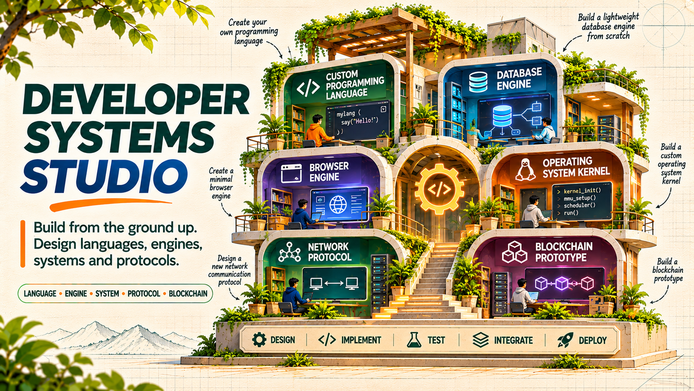
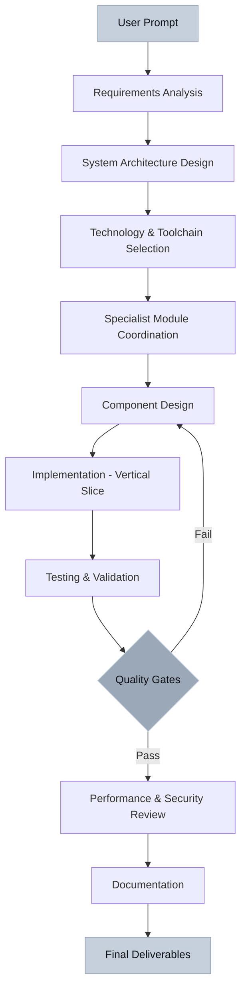

<div align="center">

   

**Engineer foundational developer systems: programming languages, compilers, operating systems, browsers, databases, networks, and blockchain infrastructure**

[Quick Start](#quick-start) • [Architecture](#master-skill-architecture) • [Modules](#internal-specialist-modules) • [Installation](#claude-code-installation) • [Documentation](#documentation-and-resources)

</div>

---

## About Developer Systems Studio

Developer Systems Studio coordinates end-to-end engineering workflows for building low-level developer technologies. This repository provides one discoverable Master Skill that orchestrates appropriate specialist modules automatically based on your requirements.

**Core Approach:**
- Explicit specifications and architecture design
- Staged implementation with vertical slices
- Conformance testing and fuzzing where appropriate
- Performance measurement and optimization
- Security review and validation
- Comprehensive technical documentation

This is an agent-driven engineering system, not prebuilt software. It guides design decisions, implementation patterns, testing strategies, and validation workflows for complex developer systems.

---

## Project Overview and Statistics

| Metric | Value | Description |
|--------|-------|-------------|
| **Discoverable Skills** | 1 | `developer-systems-studio` Master Skill |
| **Internal Modules** | 10 | Specialist engineering playbooks |
| **Human-Centered Modules** | 3 | Design quality and product experience |
| **Engineering Domains** | 7 | Languages, compilers, OS, browsers, databases, networks, blockchain |
| **Repository Structure** | Modular | Single entry point, internal references |
| **Agent Compatibility** | Universal | Claude Code, OpenCode, project-local |

---

## What Can You Build?

Developer Systems Studio helps engineer these foundational technologies:

**Programming Language Design**
- Language syntax and semantics design
- Type system architecture
- Standard library design
- Language tooling and LSP implementation

**Compiler Engineering**
- Lexical analysis and parsing
- AST and intermediate representations
- Optimization pipelines
- Code generation backends

**Operating System Development**
- Kernel architecture guidance
- Process and memory management design
- Device driver interfaces
- System call design

**Browser Engine Architecture**
- HTML/CSS parsing and DOM construction
- Layout and rendering pipeline
- JavaScript execution integration
- Web standards compliance

**Database Internals**
- Storage engine design
- Query processing and optimization
- Transaction management
- Indexing strategies

**Network Protocol Engineering**
- Protocol specification and state machines
- Reliable communication patterns
- Security and authentication layers
- Performance optimization

**Blockchain and Distributed Ledger Systems**
- Consensus mechanism design
- Transaction processing
- Smart contract architecture
- Distributed state management

---

## Master Skill Architecture

Users invoke **one Master Skill**: `developer-systems-studio`

The Master Skill:
1. Analyzes your requirements and existing project
2. Loads appropriate specialist modules as internal references
3. Coordinates the complete engineering workflow
4. Delivers specifications, implementations, tests, and documentation

**You do not manually select individual specialist modules.** The Master Skill orchestrates them automatically.

### Verification

All module names and counts verified against [`skill-manifest.json`](./skill-manifest.json).

---

## Internal Specialist Modules

The Master Skill coordinates these internal engineering playbooks:

| Module | Domain | Type |
|--------|--------|------|
| **programming-language-engineer** | Language design and semantics | Core Specialist |
| **compiler-engineer** | Compilation pipeline architecture | Core Specialist |
| **operating-system-engineer** | OS and kernel architecture | Core Specialist |
| **browser-engineer** | Browser engine internals | Core Specialist |
| **database-internals-engineer** | Database systems design | Core Specialist |
| **network-protocol-engineer** | Network protocol design | Core Specialist |
| **blockchain-engineer** | Blockchain and distributed systems | Core Specialist |
| **human-centered-product-design** | User experience and interface design | Human-Centered |
| **design-quality-critic** | Design review and quality assessment | Human-Centered |
| **product-experience-engineer** | Product usability and interaction | Human-Centered |

**Internal modules** are reference playbooks loaded by the Master Skill, not separate skills to invoke.

---

## Developer Systems Engineering Workflow



**Workflow adapts** based on the system being developed. A compiler project follows different validation steps than a database engine.

---

## Programming Language Design

When engineering programming languages, the system guides:

**Language Specification**
- Syntax and grammar definition
- Type system design (static/dynamic, inference, generics)
- Memory model and ownership semantics
- Module and package system
- Standard library architecture

**Implementation Approach**
- Lexical analysis (tokenization)
- Parsing strategies (recursive descent, parser combinators, generated parsers)
- Abstract syntax tree design
- Semantic analysis and type checking
- Error reporting and recovery

**Tooling and Ecosystem**
- Language server protocol (LSP) integration
- Build system design
- Package manager architecture
- Debugging and profiling tools

---

## Compiler and Interpreter Engineering

For compiler development workflows:

**Frontend Architecture**
- Lexer and tokenizer implementation
- Parser design and error recovery
- AST construction and validation
- Symbol table management
- Type checking and inference

**Intermediate Representation**
- IR design considerations
- SSA (Static Single Assignment) form
- Control flow graph construction
- Data flow analysis

**Optimization Pipeline**
- Constant folding and propagation
- Dead code elimination
- Loop optimization
- Inlining strategies

**Backend and Code Generation**
- Target architecture selection
- Register allocation
- Instruction selection
- Assembly generation
- Linking and executable format

---

## Operating System Development

OS engineering guidance covers:

**Kernel Architecture**
- Monolithic vs microkernel design
- Boot process and initialization
- System call interface
- Interrupt handling

**Process Management**
- Process lifecycle and scheduling
- Context switching
- Inter-process communication (IPC)
- Threading models

**Memory Management**
- Virtual memory design
- Page table structures
- Memory allocation strategies
- Cache coherency

**Device Drivers**
- Driver architecture and interfaces
- Hardware abstraction layers
- I/O scheduling
- DMA management

**File Systems**
- File system design considerations
- Journaling and reliability
- Access control and permissions

---

## Browser Engine Architecture

Browser development workflows address:

**Parsing and DOM Construction**
- HTML5 parsing algorithm
- CSS parsing and CSSOM
- DOM tree construction
- Script execution integration

**Rendering Pipeline**
- Layout calculation (box model, flexbox, grid)
- Style resolution and cascade
- Paint and compositing
- Layer management

**JavaScript Execution**
- JS engine integration (V8, SpiderMonkey, JavaScriptCore)
- Event loop and task queues
- Web APIs implementation
- Security sandboxing

**Networking Layer**
- HTTP/HTTPS protocol handling
- Caching strategies
- Connection pooling
- Resource loading priorities

---

## Database Internals and Query Processing

Database systems engineering covers:

**Storage Engine Design**
- B-tree and LSM-tree implementations
- Page management
- Buffer pool management
- Write-ahead logging (WAL)

**Query Processing**
- SQL parsing and validation
- Query optimization strategies
- Join algorithms (nested loop, hash join, merge join)
- Execution plans

**Transaction Management**
- ACID properties implementation
- Concurrency control (2PL, MVCC, OCC)
- Isolation levels
- Deadlock detection and resolution

**Indexing Strategies**
- B-tree and B+ tree indexes
- Hash indexes
- Full-text search indexes
- Spatial indexes

---

## Network Protocol Engineering

Protocol design and implementation workflows:

**Protocol Specification**
- State machine design
- Message format definition
- Handshake and negotiation
- Error handling and recovery

**Reliable Communication**
- Acknowledgment and retransmission
- Flow control
- Congestion control
- Ordering guarantees

**Security Architecture**
- Authentication mechanisms
- Encryption and key exchange
- Certificate validation
- Secure session management

**Performance Optimization**
- Connection pooling
- Pipelining and multiplexing
- Compression strategies
- Latency reduction techniques

---

## Blockchain and Distributed Ledger Systems

Blockchain engineering workflows address:

**Consensus Mechanisms**
- Proof of Work (PoW)
- Proof of Stake (PoS)
- Byzantine Fault Tolerance (BFT)
- Consensus algorithm selection

**Transaction Processing**
- Transaction validation
- UTXO vs account model
- Transaction pool management
- Fee estimation

**Smart Contract Architecture**
- Virtual machine design (EVM, WASM)
- Gas metering and limits
- Contract state management
- Security considerations

**Distributed State Management**
- Blockchain data structures
- State trie design (Patricia Merkle Tree)
- Synchronization protocols
- Light client design

---

## Human-Centered Product Design

For developer tools, system interfaces, and user-facing components:

**Information Architecture**
- Clear hierarchy and navigation
- Consistent terminology
- Logical grouping and categorization
- Efficient information access

**Visual Design**
- Professional typography
- Consistent spacing and alignment
- Meaningful color usage
- Visual feedback and states

**Interaction Design**
- Intuitive controls and affordances
- Responsive interaction states
- Error prevention and recovery
- Keyboard and accessibility support

**User Experience**
- Understandable workflows
- Progressive disclosure
- Helpful error messages
- Performance perception

These modules ensure developer tools and system interfaces are professional, accessible, and effective.

---

## Design Quality Review

The `design-quality-critic` module provides systematic review of:

- Interface clarity and consistency
- Information hierarchy effectiveness
- Interaction pattern quality
- Visual design execution
- Accessibility compliance
- Error handling appropriateness
- Documentation completeness

Applied throughout development, not as final decoration.

---

## Quick Start

### Prerequisites

Developer Systems Studio is an agent skill system. You need:
- **Claude Code** or **OpenCode** (or compatible coding agent)
- Target system development environment (language toolchains, build tools)

### Project-Local Installation

Copy the Master Skill into your project:

```bash
# From your project directory
mkdir -p .claude/skills
cp -r /path/to/developer-systems-studio/.claude/skills/developer-systems-studio .claude/skills/
```

Verify the skill appears in your agent's skill list.

### Basic Usage

Invoke the Master Skill with your requirements:

**Claude Code:**
```text
/developer-systems-studio

I need to build a bytecode interpreter for a stack-based VM with the following operations: push, pop, add, sub, mul, div, jmp, jz, call, ret. Include a disassembler and basic execution trace.
```

**OpenCode:**
```text
@developer-systems-studio

Design a simple relational database storage engine with B-tree indexes, page-based storage, and basic transaction support.
```

The Master Skill will:
1. Analyze requirements
2. Load relevant specialist modules
3. Guide architecture design
4. Coordinate implementation
5. Deliver tests and documentation

---

## Claude Code Installation

### Using Claude Code CLI

```bash
# Clone repository
git clone https://github.com/TheMamunZx/developer-systems-studio.git

# Navigate to directory
cd developer-systems-studio

# Copy skill to Claude Code config (adjust path based on your installation)
mkdir -p ~/.claude/skills
cp -r .claude/skills/developer-systems-studio ~/.claude/skills/
```

### Using Claude Code Desktop/Web

1. Clone or download this repository
2. Copy `.claude/skills/developer-systems-studio/` to your project's `.claude/skills/` directory
3. Invoke with `/developer-systems-studio`

---

## OpenCode Installation

### Project-Level Installation

```bash
# From your project root
mkdir -p .claude/skills
cp -r /path/to/developer-systems-studio/.claude/skills/developer-systems-studio .claude/skills/
```

### Global Installation

Consult OpenCode documentation for global skill installation paths, which vary by OpenCode version and configuration.

### Verification

Check skill appears in your agent's available skill listing before relying on it.

---

## Supported Languages and Technologies

Developer Systems Studio provides engineering workflows for these languages and environments:

### Programming Languages

**Systems Languages:** C, C++, Rust, Zig  
**VM Languages:** Java, C#, Go, Swift  
**Scripting Languages:** Python, JavaScript, TypeScript, Ruby, Lua  
**Functional Languages:** OCaml, Haskell, Erlang, Elixir  
**Emerging Languages:** Custom language design

### Build Systems and Toolchains

- **C/C++:** GCC, Clang, MSVC, CMake, Makefile, Meson
- **Rust:** Cargo, rustc
- **JavaScript/TypeScript:** Node.js, Bun, Deno, npm, pnpm
- **Python:** pip, Poetry, setuptools
- **JVM:** Gradle, Maven, javac
- **.NET:** MSBuild, dotnet CLI
- **Go:** go build, go modules

### Testing and Analysis Tools

- Unit testing frameworks (language-specific)
- Fuzzing tools (AFL, libFuzzer, Honggfuzz)
- Static analysis (Clang Static Analyzer, Coverity)
- Dynamic analysis (Valgrind, AddressSanitizer)
- Profiling tools (perf, Instruments, gprof)

**Important:** The system provides engineering guidance and workflows. Actual tool availability depends on your development environment. Never claims tools are configured unless verified.

---

## Development Toolchain Configuration

For each project type, configure appropriate toolchains:

### Compiler Projects

```bash
# Example: C++ compiler project
- C++ compiler (GCC 11+, Clang 14+)
- CMake 3.20+
- LLVM development libraries (if using LLVM backend)
- Testing framework (Google Test, Catch2)
- Benchmarking tools
```

### Operating System Projects

```bash
# Example: Kernel development
- Cross-compiler toolchain (target architecture)
- Assembler (NASM, GAS)
- Linker scripts
- Bootloader tools (GRUB, Limine)
- Emulator (QEMU, Bochs) or hardware
- Debugger (GDB with QEMU integration)
```

### Database Projects

```bash
# Example: Storage engine
- C++ or Rust toolchain
- Testing framework with persistence validation
- Benchmarking tools (sysbench, YCSB)
- Profiling tools for I/O analysis
```

The Master Skill inspects your environment and guides configuration based on discovered capabilities.

---

## Architecture and System Design

### Coordinated Engineering Process

1. **Requirements Analysis:** Parse user goals, constraints, target platform
2. **Architecture Design:** Define components, interfaces, data flow, invariants
3. **Technology Selection:** Choose appropriate languages, libraries, tools
4. **Specification:** Document behavior, edge cases, non-goals
5. **Incremental Implementation:** Build vertical slices before horizontal expansion
6. **Validation:** Conformance tests, fuzz tests, benchmarks
7. **Security Review:** Input validation, memory safety, threat modeling
8. **Documentation:** Architecture diagrams, API docs, build instructions

### Quality Gates

Every deliverable passes these gates:

- **Correctness:** Tests demonstrate specified behavior
- **Buildability:** Project builds with documented dependencies
- **Testability:** Critical flows and invariants covered
- **Security:** Input handling, memory safety, isolation reviewed
- **Accessibility:** User-facing interfaces meet WCAG standards where applicable
- **Documentation:** Implementation matches documentation

Partial completion explicitly stated with evidence.

---

## Testing and Validation

### Test Coverage Approach

**Unit Tests**
- Component-level behavior validation
- Edge case coverage
- Error handling verification

**Integration Tests**
- Component interaction validation
- End-to-end workflow tests
- System behavior verification

**Conformance Tests**
- Specification compliance
- Standards adherence (where applicable)
- Reference implementation comparison

**Fuzz Testing**
- Input validation robustness
- Parser crash resistance
- Memory safety verification

**Regression Tests**
- Bug fix validation
- Behavior preservation
- Performance regression detection

### Validation Workflow

```bash
# Example validation commands (project-specific)
python scripts/validate_pack.py          # Repository structure validation
make test                                # Unit and integration tests
make fuzz                                # Fuzzing campaign
make bench                               # Performance benchmarks
```

Actual test commands depend on project build system.

---

## Security and Reliability

### Security Considerations

**Input Validation**
- Parser input sanitization
- Protocol message validation
- SQL injection prevention
- Command injection prevention

**Memory Safety**
- Buffer overflow prevention
- Use-after-free elimination
- Memory leak detection
- Safe pointer management

**Isolation and Sandboxing**
- Process isolation
- Capability-based security
- Least privilege principles
- Resource limits

**Cryptographic Security**
- Secure key management
- Proper algorithm selection
- Constant-time implementations
- Certificate validation

### Reliability Patterns

- Graceful error handling
- Failure recovery mechanisms
- Resource cleanup
- State consistency verification
- Idempotent operations where applicable

**No security or correctness claims without actual testing and verification.**

---

## Build and Deployment

### Repository Validation

```bash
# Validate repository structure, references, and basic integrity
python scripts/validate_pack.py
```

Checks:
- Master Skill presence and frontmatter
- Expected reference file existence
- Basic link integrity
- Accidental secret detection

**Does not prove provider/API availability or production behavior.**

### Creating New Projects

```bash
# Scaffold new developer systems project
python scripts/new_project.py --name my-project --type compiler
```

Adjust based on actual script capabilities.

---

## Output Structure and Deliverables

Typical project deliverables:

### Specifications
- Architecture diagrams (Mermaid, PlantUML)
- Component specifications
- Interface definitions
- State machine diagrams
- Protocol specifications

### Implementation
- Source code with clear organization
- Build system configuration
- Dependency management
- Installation instructions

### Testing Artifacts
- Unit test suites
- Integration tests
- Conformance test cases
- Fuzzing harnesses
- Benchmark suites

### Documentation
- Architecture overview
- API documentation
- Build and deployment guides
- Performance characteristics
- Known limitations and future work

---

## Troubleshooting and FAQ

### Skill Not Appearing

**Problem:** Agent doesn't recognize `/developer-systems-studio`

**Solutions:**
1. Verify `.claude/skills/developer-systems-studio/SKILL.md` exists
2. Check skill frontmatter is valid YAML
3. Restart agent or reload configuration
4. Confirm agent version supports skill discovery

### Module Loading Issues

**Problem:** Specialist module references fail to load

**Solutions:**
1. Verify all reference files exist in `references/` directory
2. Check file names match references in `SKILL.md`
3. Validate file permissions
4. Run `python scripts/validate_pack.py`

### Build Failures

**Problem:** Generated code doesn't build

**Diagnosis:**
1. Check toolchain availability and versions
2. Verify all dependencies documented
3. Review build error messages
4. Confirm platform compatibility

**Resolution:** Provide error messages to Master Skill for diagnosis and fixes.

### Test Failures

**Problem:** Delivered tests fail

**Approach:**
1. Review test expectations vs implementation
2. Check for environment-specific issues
3. Validate test data and fixtures
4. Report failures for correction

### Performance Issues

**Problem:** Generated implementation is slow

**Optimization:**
1. Profile actual bottlenecks (don't guess)
2. Request specific optimization guidance
3. Provide performance requirements upfront
4. Consider algorithm and data structure changes

### FAQ

**Q: Does this install a compiler/OS/database automatically?**  
A: No. This is an agent skill system that guides engineering workflows. You implement actual systems with the agent's guidance.

**Q: Can I use this without Claude Code or OpenCode?**  
A: The skill format is designed for compatible coding agents. Manual reference reading is possible but loses coordination benefits.

**Q: Which specialist module should I invoke?**  
A: Invoke only the Master Skill (`developer-systems-studio`). It coordinates specialist modules automatically.

**Q: Does this guarantee production-ready code?**  
A: No. All outputs require review, testing, and validation. Security and correctness are verified, never assumed.

**Q: Can I customize specialist modules?**  
A: Yes. Fork the repository and modify `references/` files. Update `skill-manifest.json` accordingly.

**Q: What license governs this repository?**  
A: Check repository license file. Specialist modules are internal references, not separate products.

---

## Documentation and Resources

### Repository Documentation

- **[SKILL.md](.claude/skills/developer-systems-studio/SKILL.md)** — Master Skill definition
- **[AGENTS.md](./AGENTS.md)** — Agent operating guide
- **[CONSOLIDATION_MAP.md](./CONSOLIDATION_MAP.md)** — Module organization
- **[CHANGELOG.md](./CHANGELOG.md)** — Version history
- **[skill-manifest.json](./skill-manifest.json)** — Repository metadata

### Specialist Module References

Located in [`.claude/skills/developer-systems-studio/references/`](.claude/skills/developer-systems-studio/references/):

- [programming-language-engineer.md](.claude/skills/developer-systems-studio/references/programming-language-engineer.md)
- [compiler-engineer.md](.claude/skills/developer-systems-studio/references/compiler-engineer.md)
- [operating-system-engineer.md](.claude/skills/developer-systems-studio/references/operating-system-engineer.md)
- [browser-engineer.md](.claude/skills/developer-systems-studio/references/browser-engineer.md)
- [database-internals-engineer.md](.claude/skills/developer-systems-studio/references/database-internals-engineer.md)
- [network-protocol-engineer.md](.claude/skills/developer-systems-studio/references/network-protocol-engineer.md)
- [blockchain-engineer.md](.claude/skills/developer-systems-studio/references/blockchain-engineer.md)
- [human-centered-product-design.md](.claude/skills/developer-systems-studio/references/human-centered-product-design.md)
- [design-quality-critic.md](.claude/skills/developer-systems-studio/references/design-quality-critic.md)
- [product-experience-engineer.md](.claude/skills/developer-systems-studio/references/product-experience-engineer.md)

### External Learning Resources

**Programming Language Design:**
- "Crafting Interpreters" by Robert Nystrom
- "Programming Language Pragmatics" by Michael L. Scott
- "Types and Programming Languages" by Benjamin Pierce

**Compiler Engineering:**
- "Engineering a Compiler" by Cooper & Torczon
- "Modern Compiler Implementation" series by Andrew Appel
- LLVM Documentation

**Operating Systems:**
- "Operating Systems: Three Easy Pieces" by Remzi Arpaci-Dusseau
- "The Design and Implementation of the FreeBSD Operating System"
- OSDev Wiki

**Database Systems:**
- "Database Internals" by Alex Petrov
- "Designing Data-Intensive Applications" by Martin Kleppmann
- CMU Database Course Materials

**Network Protocols:**
- "TCP/IP Illustrated" by W. Richard Stevens
- IETF RFCs (protocol specifications)
- "Computer Networking: A Top-Down Approach"

**Blockchain Systems:**
- Bitcoin and Ethereum whitepapers
- "Mastering Bitcoin" and "Mastering Ethereum" by Andreas Antonopoulos
- Consensus research papers (PBFT, Raft, etc.)

---

## Repository Layout

```text
developer-systems-studio/
├── .claude/
│   └── skills/
│       └── developer-systems-studio/
│           ├── SKILL.md                    # Master Skill definition
│           ├── references/                  # Internal specialist modules
│           │   ├── INDEX.md
│           │   ├── programming-language-engineer.md
│           │   ├── compiler-engineer.md
│           │   ├── operating-system-engineer.md
│           │   ├── browser-engineer.md
│           │   ├── database-internals-engineer.md
│           │   ├── network-protocol-engineer.md
│           │   ├── blockchain-engineer.md
│           │   ├── human-centered-product-design.md
│           │   ├── design-quality-critic.md
│           │   └── product-experience-engineer.md
│           ├── templates/                   # Project templates
│           │   ├── decision-log.md
│           │   └── delivery-report.md
│           └── scripts/                     # Module-specific utilities
├── assets/
│   └── developer-systems-studio-banner.png  # Repository banner
├── scripts/
│   ├── validate_pack.py                     # Repository validation
│   └── new_project.py                       # Project scaffolding
├── README.md                                # This file
├── README_BN.md                             # Bengali documentation
├── AGENTS.md                                # Agent operating guide
├── CHANGELOG.md                             # Version history
├── CONSOLIDATION_MAP.md                     # Module organization
└── skill-manifest.json                      # Repository metadata
```

---

## Safety and Service Requirements

**This repository contains:**
- Agent skill definitions and playbooks
- Engineering guidance and workflows
- Project templates and validation scripts
- Documentation and references

**This repository is NOT:**
- A compiled software product
- An API service or cloud runtime
- A model or AI system
- A deployment service
- Media generation software

**Actual capabilities depend on:**
- Your development environment tools and dependencies
- Configured credentials and permissions
- Provider terms, quotas, and availability
- Target hardware and platform
- Your agent's tool access and capabilities

**Security:**
- Never commit secrets, API keys, tokens, or credentials
- Review all generated code before execution
- Validate dependencies and licenses
- Test thoroughly before production use
- Follow secure coding practices

---

## Contribution and Updates

### Contributing

Keep Master Skill as sole discoverable entry point. Add specialist knowledge as internal references unless exposing new independent skill is deliberate decision.

When adding modules:
1. Create reference file in `references/` directory
2. Update `SKILL.md` internal reference map
3. Update `skill-manifest.json` module list
4. Run `python scripts/validate_pack.py`
5. Update this README with new module documentation

### Maintenance

- Update specialist modules for new patterns and best practices
- Maintain compatibility with Claude Code and OpenCode updates
- Keep external resource links current
- Document breaking changes in CHANGELOG.md

---

<div align="center">

**Developer Systems Studio** — Engineering foundational developer technologies through systematic design, implementation, and validation.

🔗 **Links:** [Repository](https://github.com/TheMamunZx/developer-systems-studio) • [Issues](https://github.com/TheMamunZx/developer-systems-studio/issues) • [Discussions](https://github.com/TheMamunZx/developer-systems-studio/discussions)

</div>
